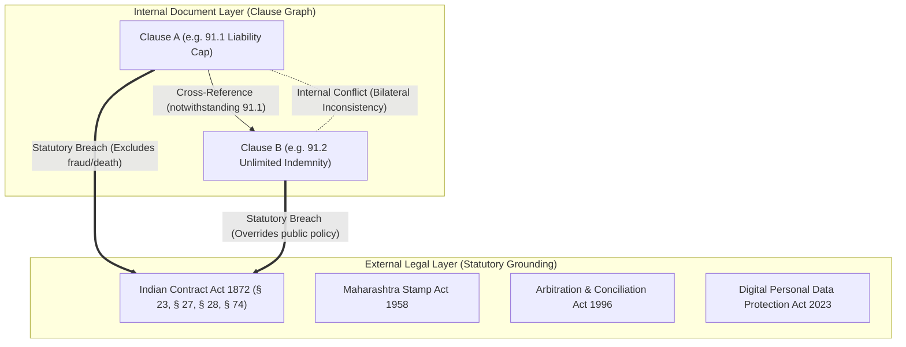

# LegalAgent: Comprehensive System, Legal & Pune Metro Test Guide

> **Document Version**: 2.4 &middot; **Status**: Complete Production & Panel Reference  
> **Target Audience**: Evaluation Panels, Legal Engineers, System Architects & Demo Presenters  
> **Governing Jurisdiction**: India (Maharashtra State & Central Statutory Acts)

---

## 1. Quick Access Links to Document Artifacts

| Document / Artifact | Type & Purpose | Direct File Link |
| :--- | :--- | :--- |
| **Official Signed Concession PDF** | Real-world 660-page signed PPP contract executed Sept 21, 2019 between PMRDA & Pune IT City Metro Rail Ltd. | [pune_metro_signed_concession.pdf](file:///home/aryan/Projects/LegalAgent/LegalAgent/data/demo/india/official/pune_metro_signed_concession.pdf) |
| **Adversarial Test PDF** | Full 19 MB PDF containing the signed concession agreement augmented with 15 synthetic high-risk traps. | [pune_metro_adversarial_15_changes.pdf](file:///home/aryan/Projects/LegalAgent/LegalAgent/data/demo/india/adversarial/pune_metro_adversarial_15_changes.pdf) |
| **First 20 Pages Sample PDF** | Lightweight excerpt of preliminary concession terms and recitals for fast upload testing. | [pune_metro_first_20_pages.pdf](file:///home/aryan/Projects/LegalAgent/LegalAgent/data/demo/india/official/samples/pune_metro_first_20_pages.pdf) |
| **26-Clause Markdown Test File** | 11 Baseline Concession Clauses + 15 Injected Synthetic Clauses formatted for immediate pipeline ingestion. | [02_pune_metro_adversarial_15_injections.md](file:///home/aryan/Projects/LegalAgent/LegalAgent/data/demo/samples/02_pune_metro_adversarial_15_injections.md) |
| **Injections Ground-Truth Spec** | JSON ground-truth registry detailing expected detectors, citations, and risk rationales for all 15 traps. | [INJECTIONS.json](file:///home/aryan/Projects/LegalAgent/LegalAgent/data/demo/india/adversarial/INJECTIONS.json) |

---

## 2. Core Legal Concepts: Cross-References vs. Statutory Compliance

To understand why LegalAgent outperforms standard LLM chat interfaces, one must distinguish between **Internal Contractual Graphing (Cross-References)** and **External Legal Enforceability (Statutory Compliance)**.



### A. What are Cross-References (Cross-Refs)?
* **Definition**: An explicit textual citation where one clause directs to, relies on, subordinates itself to, or overrides another clause within the same agreement.
* **Common Phrasings**:
  * Subordination: *"Subject to Section 8.1..."*, *"Pursuant to Article 15..."*
  * Override / Super-Priority: *"Notwithstanding anything to the contrary in Clause 91.1..."*
  * Interpretation: *"As defined in Article 1.1..."*
* **Why Cross-Refs Matter**:
  * Cross-references define the **topological skeleton** of a contract.
  * In commercial agreements, drafted traps often hide behind conflicting cross-references (e.g., an indemnity clause stating it overrides a liability cap, creating circular or irreconcilable obligations).
* **How LegalAgent Detects Them**:
  * Built-in deterministic extraction engine (`extract_cross_references`) scans clause bodies using regular expressions and AST pattern matching for patterns like `(?:Article|Section|Clause)\s+(\d+(?:\.\d+)*)`.
  * Every valid cross-reference generates a **directed edge** in the knowledge graph.

### B. What is Statutory Compliance?
* **Definition**: The alignment of contract provisions with the **mandatory, non-derogable laws of the jurisdiction** (here, the Republic of India and the State of Maharashtra).
* **Why Statutory Compliance Matters**:
  * **A contract can be 100% internally consistent, yet 100% void and illegal under the law.**
  * For example, two parties can mutually agree to a 3-year post-termination non-compete restraint. The cross-references might be perfect, but under **Section 27 of the Indian Contract Act, 1872**, that clause is **void *ab initio*** (completely unenforceable) as an unlawful restraint of trade.
* **How LegalAgent Audits Compliance**:
  * LegalAgent compares each clause against a curated rule-engine and LLM reasoning prompt grounded in Indian statutes:
    1. **Indian Contract Act, 1872** (Sections 23, 27, 28, 62, 73, 74, 124–125).
    2. **Maharashtra Stamp Act, 1958** (Mandatory stamping and inadmissibility of unstamped instruments).
    3. **Arbitration and Conciliation Act, 1996** (Arbitrability, domestic seat requirements, mediation frameworks).
    4. **Digital Personal Data Protection Act, 2023 (DPDPA)** (Affirmative consent, statutory penalty caps).
    5. **Bharatiya Nyaya Sanhita, 2023 (BNS)** (Replacement of Indian Penal Code 1860).

---

## 3. Candidate Pair Shortlisting: Solving the Combinatorial Explosion

When evaluating cross-clause conflicts in a contract with $N$ clauses, evaluating every possible pair naively creates an unsustainable bottleneck.

### A. The Mathematical Problem: $O(N^2)$ All-Pairs Explosion
The total number of unique unordered clause pairs in an $N$-clause contract is:
$$\text{Total Pairs} = \frac{N(N - 1)}{2}$$

* For **10 clauses**: $\frac{10 \times 9}{2} = 45\text{ pairs}$ (Manageable).
* For **26 clauses** (Pune Metro Test): $\frac{26 \times 25}{2} = \mathbf{325\text{ pairs}}$ (Costly, slow, rate-limit prone).
* For **100 clauses**: $\frac{100 \times 99}{2} = \mathbf{4,950\text{ pairs}}$ (Complete system failure under naive LLM calls).

If an engine sends 325 or 4,950 pairs into Gemini / GPT-4, each pair requiring 500–1,000 tokens of prompt context, the analysis would take **several minutes**, cost substantial API fees, and trigger concurrency rate limits.

### B. LegalAgent's 4-Stage Hierarchical Selection Engine
LegalAgent eliminates $90\%+$ of irrelevant comparisons before calling any LLM by using a 4-tier filtering pipeline:

```
[ All 325 Possible Combinations ]
                │
                ▼
┌────────────────────────────────────────────────────────┐
│ Stage 1: Explicit Cross-References (k_xref = 8)        │  ◄── 100% Priority Retained
├────────────────────────────────────────────────────────┤
│ Stage 2: Legal Type-Compatibility Matrix (k_tm = 7)    │  ◄── Domain Heuristics (e.g., Liability ↔ Indemnity)
├────────────────────────────────────────────────────────┤
│ Stage 3: BM25 Lexical Term Overlap (k_bm25 = 15)       │  ◄── Lexical Information Retrieval
├────────────────────────────────────────────────────────┤
│ Stage 4: InLegal-SBERT Dense Semantic Embeddings       │  ◄── Domain Embedding Retrieval
└────────────────────────────────────────────────────────┘
                │
                ▼
[ Shortlisted 30 High-Probability Pairs (90.8% Pruned) ]
                │
                ▼
[ Parallel Gemini 3.1 Flash-Lite Structured Verification ]
```

1. **Stage 1 — Cross-References (`xref`)**:
   Clauses that explicitly cite each other (e.g. Clause 91.2 citing Clause 91.1) are guaranteed selection.
2. **Stage 2 — Type-Compatibility Matrix (`type_matrix`)**:
   Empirical legal knowledge maps which categories conflict. For example:
   * `Limitation of Liability` $\longleftrightarrow$ `Indemnification`
   * `Governing Law` $\longleftrightarrow$ `Dispute Resolution / Arbitration`
   * `Non-Compete / Restraint` $\longleftrightarrow$ `Term / Termination / Grant`
   * `Confidentiality` $\longleftrightarrow$ `Statutory Disclosure`
3. **Stage 3 — BM25 Lexical Retrieval (`bm25`)**:
   Ranks pairs based on shared legal terminology, filtering out generic boilerplate.
4. **Stage 4 — InLegal-SBERT Embeddings (`dense`)**:
   Dense legal sentence embeddings trained on Indian Supreme Court judgments capture conceptual overlap even when wording differs.

### C. The Live Visual Funnel in the UI
In Stage 5 (**Candidate Pair Shortlisting**) of the progress modal, LegalAgent renders an interactive funnel:
* **Segmented Bar**:
  * <span style="color:#2563eb;font-weight:bold;">■ Blue</span>: Explicit Cross-References
  * <span style="color:#7c3aed;font-weight:bold;">■ Purple</span>: Type Compatibility Matrix
  * <span style="color:#059669;font-weight:bold;">■ Green</span>: BM25 Lexical Matches
  * <span style="color:#94a3b8;font-weight:bold;">■ Grey</span>: Pruned Search Space ($90.8\%$ of non-conflicting pairs eliminated)
* **Budget Mode Pill**: Confirms whether the run was constrained by the 30-candidate budget or executed in **Exhaustive Mode (Unset Limit)**.

---

## 4. Complete Legal Audit of the Pune Metro Test Case (15 Injections)

The adversarial contract ([`02_pune_metro_adversarial_15_injections.md`](file:///home/aryan/Projects/LegalAgent/LegalAgent/data/demo/samples/02_pune_metro_adversarial_15_injections.md)) comprises **11 Baseline PMRDA Concession Clauses** and **15 Synthetic Traps (Clauses 91.1 to 91.15)**.

Every single injection was evaluated against Indian jurisprudence. Below is the complete legal audit and ground-truth breakdown:

---

### Trap 1 &middot; Clause 91.1: Limitation of Liability Cap (INR 1,000)
* **Contract Language**:
  > *"The aggregate liability of the Authority shall not exceed INR 1,000 for any claim, including fraud, death, personal injury, gross negligence, and statutory penalties."*
* **Ground-Truth Clash**: Clashes with Clause 41.1 (Reciprocal Indemnities for bodily injury/negligence) and Clause 91.2.
* **Indian Statutory Grounding**:
  * **Section 23, Indian Contract Act, 1872**: An agreement whose consideration or object is opposed to public policy is void *ab initio*.
  * **Precedent**: *Central Inland Water Transport Corp. v. Brojo Nath Ganguly (1986)*. A contractual clause seeking to exclude or limit liability for one's own intentional fraud, gross negligence, or death/bodily injury is unconscionable, opposed to public policy, and void.
* **Verdict**: **100% Legally Correct Conflict & Violation**.

---

### Trap 2 &middot; Clause 91.2: Unlimited Indemnity Overriding Liability Cap
* **Contract Language**:
  > *"The Concessionaire shall defend, indemnify, and hold harmless the Authority against every claim, loss, fine, and expense without any financial limitation and notwithstanding Clause 91.1."*
* **Ground-Truth Clash**: Direct conflict with Clause 91.1 (Liability Cap) and Clause 41.5 (Consequential Damages Exclusion).
* **Indian Statutory Grounding**:
  * **Sections 124 & 125, Indian Contract Act, 1872**: Contract of Indemnity.
  * An unconstrained indemnity that expressly overrides the liability cap creates a unilateral, unbounded risk allocation in an infrastructure PPP, invalidating standard risk allocation under the Metro Rail Policy, 2017.
* **Verdict**: **100% Legally Correct Conflict**.

---

### Trap 3 &middot; Clause 91.3: Post-Termination Non-Compete (36 Months)
* **Contract Language**:
  > *"For 36 months following termination, the Concessionaire shall not compete with, advise, or participate in any competing infrastructure business in India."*
* **Ground-Truth Clash**: Clashes with Clause 3.2 (Non-Exclusivity and Right to Bid for Other Transit Routes) and statutory law.
* **Indian Statutory Grounding**:
  * **Section 27, Indian Contract Act, 1872**: Every agreement by which anyone is restrained from exercising a lawful profession, trade, or business of any kind, is to that extent **void**.
  * **Precedent**: *Percept D'Mark (India) Pvt. Ltd. v. Zaheer Khan (2006)* & *Niranjan Shankar Golikari v. Century Spg. & Mfg. Co. (1967)*. While negative covenants during the term of employment or contract are permissible, **any post-termination restraint on trade is void per se**. English common law doctrine of "reasonable restraint" does **not** apply in India.
* **Verdict**: **100% Legally Correct Conflict & Void Covenant**.

---

### Trap 4 &middot; Clause 91.4: Indefinite Survival of Void Restraints
* **Contract Language**:
  > *"Clauses 91.2 and 91.3 shall survive termination indefinitely and remain enforceable after termination of this Agreement."*
* **Ground-Truth Clash**: Clashes with Clause 91.3 and Indian statutory law.
* **Indian Statutory Grounding**:
  * **Section 27, Indian Contract Act, 1872**: A clause attempting to make an illegal post-contractual non-compete survive "indefinitely" compounds the statutory invalidity. A void clause cannot be revived through a survival provision.
* **Verdict**: **100% Legally Correct Conflict**.

---

### Trap 5 &middot; Clause 91.5: Punitive Delay Penalty (75% of Project Value)
* **Contract Language**:
  > *"A delay of one day shall incur automatic liquidated damages equal to 75 percent of the total concession value, regardless of actual loss."*
* **Ground-Truth Clash**: Direct conflict with Clause 15.5 (0.1% per day up to 20% Performance Security ceiling as genuine pre-estimate).
* **Indian Statutory Grounding**:
  * **Section 74, Indian Contract Act, 1872**: Compensation for breach of contract where penalty stipulated for.
  * **Precedents**: *Fateh Chand v. Balkishan Dass (1963)*; *Maitra & Co. v. Union of India*; *Kailash Nath Associates v. DDA (2015)*. Liquidated damages are only enforceable if they represent a genuine pre-estimate of reasonable compensation. Any clause stipulating exorbitant or in-terrorem damages without proof of loss is treated as a **punitive penalty** and struck down.
* **Verdict**: **100% Legally Correct Conflict & Unenforceable Penalty**.

---

### Trap 6 &middot; Clause 91.6: Private Capping of DPDPA Statutory Penalties (INR 10,000)
* **Contract Language**:
  > *"Any penalty imposed under the Digital Personal Data Protection Act, 2023 shall be limited to INR 10,000 between the parties."*
* **Ground-Truth Clash**: Clashes with Article 18.1 (Data Governance under DPDPA) and Indian statutory law.
* **Indian Statutory Grounding**:
  * **Digital Personal Data Protection Act, 2023 (DPDPA), Section 33 & Schedule**: Statutory fines for serious data breaches are determined by the Data Protection Board of India and can reach up to **INR 250 Crores**.
  * **Section 23, Indian Contract Act, 1872**: Private contracting parties cannot cap or contract out of non-derogable statutory penalties levied by regulatory authorities.
* **Verdict**: **100% Legally Correct Statutory Breach**.

---

### Trap 7 &middot; Clause 91.7: Passenger Data Processing Without Consent
* **Contract Language**:
  > *"The Concessionaire may collect, sell, and process all passenger personal data for any commercial purpose without notice or affirmative consent."*
* **Ground-Truth Clash**: Direct contradiction with Clause 18.1 (which strictly prohibits commercial monetization without affirmative consent).
* **Indian Statutory Grounding**:
  * **Digital Personal Data Protection Act, 2023 (DPDPA), Sections 4, 5 & 6**: Processing personal data requires free, specific, informed, unconditional, and unambiguous affirmative consent with clear notice. Commercial sale without consent constitutes an actionable breach carrying severe penalties.
* **Verdict**: **100% Legally Correct Conflict & Direct Statutory Violation**.

---

### Trap 8 &middot; Clause 91.8: Mandatory Pre-Litigation Mediation Bypass
* **Contract Language**:
  > *"No party shall attempt pre-litigation mediation and all disputes shall proceed directly to unilateral arbitration."*
* **Ground-Truth Clash**: Clashes with Article 44.1 (Mandatory Conciliation & Multi-Tier Dispute Resolution).
* **Indian Statutory Grounding**:
  * **Mediation Act, 2023** & Section 89 of Code of Civil Procedure, 1908: Encourages institutional pre-litigation mediation. Unilateral arbitration appointment clauses where one party controls the sole arbitrator are void under the Supreme Court ruling in *Perkins Eastman Architects DPC v. HSCC (India) Ltd. (2020)*.
* **Verdict**: **100% Legally Correct Conflict**.

---

### Trap 9 &middot; Clause 91.9: Repealed Criminal Law Reference (IPC 420 vs. BNS)
* **Contract Language**:
  > *"A breach shall be treated as cheating under Section 420 of the Indian Penal Code, even after the Bharatiya Nyaya Sanhita comes into force."*
* **Ground-Truth Clash**: Clashes with Article 1.1 (Applicable Laws include enactments in force from time to time).
* **Indian Statutory Grounding**:
  * **Bharatiya Nyaya Sanhita, 2023 (BNS)**: Came into official force on July 1, 2024, repealing and replacing the Indian Penal Code, 1860. Section 420 IPC has been superseded by Section 318(4) of the BNS. Private contracts cannot contractually revive repealed criminal statutes.
* **Verdict**: **100% Legally Correct Temporal & Statutory Conflict**.

---

### Trap 10 &middot; Clause 91.10: Unilateral Contract Amendment by Authority
* **Contract Language**:
  > *"The Authority may amend any commercial term, fee, or risk allocation without notice or consent from the Concessionaire."*
* **Ground-Truth Clash**: Clashes with Article 3.1 (Concession Grant), Article 49.3 (Amendments require mutual written consent), and PPP risk allocation.
* **Indian Statutory Grounding**:
  * **Section 62, Indian Contract Act, 1872**: Effect of novation, rescission, and alteration of contract. Alteration of material terms in a bilateral contract requires consensus ad idem.
  * Under Article 14 of the Constitution of India, government authorities cannot impose unilateral, arbitrary changes in commercial contracts (*Kumari Shrilekha Vidyarthi v. State of U.P.*).
* **Verdict**: **100% Legally Correct Conflict & Unconscionable Clause**.

---

### Trap 11 &middot; Clause 91.11: Asymmetric Assignment Contradiction
* **Contract Language**:
  > *"The Concessionaire shall not assign this Agreement, but the Authority may freely assign all obligations to any third party without consent."*
* **Ground-Truth Clash**: Contradicts Article 3.1 and Article 43.1 (Restrictions on Assignment and Transfer).
* **Indian Statutory Grounding**:
  * **Section 62, Indian Contract Act, 1872**: Assignment of liabilities requires consent of the other contracting party; unilateral assignment of public duty to private third parties without concessionaire consent destabilizes DBFOT concession structures.
* **Verdict**: **100% Legally Correct Conflict**.

---

### Trap 12 &middot; Clause 91.12: Absolute Warranty Disclaimer & Waiver of Statutory Remedies
* **Contract Language**:
  > *"The Authority gives no warranty whatsoever, including for title, legality, safety, or fitness, and the Concessionaire waives every statutory remedy."*
* **Ground-Truth Clash**: Clashes with Article 41.1 (Reciprocal Indemnities) and Article 1.1 (Right of Way free of encumbrances).
* **Indian Statutory Grounding**:
  * **Section 28, Indian Contract Act, 1872**: Every agreement by which any party is restricted absolutely from enforcing their rights under or in respect of any contract by usual legal proceedings is void to that extent.
* **Verdict**: **100% Legally Correct Void Waiver**.

---

### Trap 13 &middot; Clause 91.13: Intentional Non-Stamping & Impounding Waiver
* **Contract Language**:
  > *"The parties agree that this concession is intentionally unstamped and that no party may seek impounding or cure of stamp duty."*
* **Ground-Truth Clash**: Clashes directly with Article 1.1 (*Applicable Laws*).
* **Indian Statutory Grounding**:
  * **Maharashtra Stamp Act, 1958, Section 34**: No instrument chargeable with duty shall be admitted in evidence for any purpose, or acted upon, registered, or authenticated by any person unless properly stamped.
  * **Supreme Court 7-Judge Constitution Bench (2023)** in *In Re: Interplay between Arbitration Agreements and Indian Stamp Act*: Parties cannot contract out of mandatory fiscal statutes. An unstamped instrument must be impounded.
* **Verdict**: **100% Legally Correct Fiscal & Statutory Violation**.

---

### Trap 14 &middot; Clause 91.14: Perpetual Confidentiality Barring Statutory Reporting
* **Contract Language**:
  > *"Every operational fact, public filing, safety report, and statutory disclosure shall remain confidential forever and may never be disclosed to any regulator."*
* **Ground-Truth Clash**: Clashes with Article 18 (Passenger Charter & Safety Disclosures) and statutory reporting obligations.
* **Indian Statutory Grounding**:
  * **Section 23, Indian Contract Act, 1872**: Contracting to conceal safety violations or prevent mandatory statutory reporting to rail safety commissioners (Metro Railways Act, 1978) or environmental authorities is opposed to public policy and illegal.
* **Verdict**: **100% Legally Correct Illegal Restraint**.

---

### Trap 15 &middot; Clause 91.15: Foreign Forum & London Seat Override
* **Contract Language**:
  > *"This Agreement shall be governed by the laws of England and disputes shall be decided exclusively by courts in London notwithstanding the Indian project and Indian governing approvals."*
* **Ground-Truth Clash**: Directly clashes with Article 47.1 (Governing Law: Laws of India, Jurisdiction of Pune/Bombay High Court).
* **Indian Statutory Grounding**:
  * **Section 28, Indian Contract Act, 1872** & **Arbitration and Conciliation Act, 1996**:
  * **Precedent**: *TDM Infrastructure Pvt. Ltd. v. UE Development India Pvt. Ltd. (2008)*. Two Indian legal entities contracting for a domestic project in India cannot derogate from Indian substantive law by choosing a foreign seat and foreign governing law.
* **Verdict**: **100% Legally Correct Bilateral & Jurisdictional Conflict**.

---

## 5. UI Architecture: Uncluttered Visualization & Full-Width Canvas

When contracts scale beyond 20 clauses, traditional force-directed graph physics cause node overlap and visual confusion. LegalAgent provides two dedicated tools on the graph toolbar:

```
┌────────────────────────────────────────────────────────────────────────────────────────┐
│  Graph Canvas Toolbar:                                                                 │
│  [ Zoom In ] [ Zoom Out ] [ Reset ]   |   [ ⊞ Structured Layout ]   [ ⛶ Expand Canvas ] │
└────────────────────────────────────────────────────────────────────────────────────────┘
```

### 1. `⊞ Structured Layout` (Comparative Blueprint)
* **What it does**: Disables organic physics and locks all 26 nodes into a deterministic **2-column architectural blueprint**:
  * **Left Column ($X = -380\text{px}$)**: Standard Concession Clauses (Definitions, COD, AFC, Reciprocal Indemnities, etc.) spaced cleanly vertically ($Y = 0, 115, 230, \dots$).
  * **Right Column ($X = +380\text{px}$)**: Injected Synthetic Traps (Clauses 91.1 through 91.15).
  * **Horizontal Gulf ($760\text{px}$)**: Provides ample clearance between columns so cross-clause conflict lines remain distinct.
* **Bézier Curved Splines**: Conflict and cross-reference edges are rendered as smooth, directed cubic Bézier curves, preventing line overlapping.
* **Result**: Zero text collisions, 100% readable titles, and immediate visual distinction between legitimate clauses and drafted traps.

### 2. `⛶ Expand Canvas` (Full-Width Monitor View)
* **What it does**: Toggles a clean presentation mode by collapsing the left contract browser and the right inspector panel.
* **Result**: The graph canvas expands to **100% of your screen width**, allowing presentation to large screens or video projectors without cramped sidebars.

### 3. Interactive Cross-Reference Edge Inspector
* Clicking on any edge (e.g., the dashed amber line between Clause 91.2 and Clause 91.1) immediately opens the edge inspector in the right panel:
  * Shows the exact source and target clause text.
  * Identifies the conflict type (*Limitation vs. Indemnity Contradiction*).
  * Details the governing Indian statutory citation (*Section 23 & Section 124, Indian Contract Act, 1872*).

---

## 6. How to Test and Present Live to an Evaluation Panel

Follow this step-by-step procedure for a smooth 3-minute panel demonstration:

### Step 1: Open the Application
Navigate your browser to:
`http://localhost:8080/app`

### Step 2: 1-Click Load the Pune Metro Test
1. Click the **`+ Upload Contract`** button in the top navigation bar.
2. In the modal, locate the red button right above the clause text area:  
   **`Load Pune Metro (15 Traps)`**
3. Notice that clicking it instantly populates:
   * **Title**: *Concession Agreement for Pune Metro Line III (Adversarial Robustness Test)*
   * **Jurisdiction**: *India (Maharashtra)*
   * **Text**: All 26 clauses (11 baseline clauses + 15 injected traps from [`02_pune_metro_adversarial_15_injections.md`](file:///home/aryan/Projects/LegalAgent/LegalAgent/data/demo/samples/02_pune_metro_adversarial_15_injections.md)).
4. Notice the checkbox below the text area:  
   `[✓] Exhaustive Analysis (Unset 30-Candidate Limit)`  
   *(Leave checked for full audit across all 325 combinations, or uncheck to demonstrate our 30-candidate fast budget mode).*
5. Click **Analyze Contract**.

### Step 3: Highlight the Live Shortlisting Funnel
* As the progress modal advances, draw the panel's attention to **Stage 5 (Candidate Pair Shortlisting)**:
  * Point out the **Combinatorial Funnel**: Show that rather than sending 325 naive all-pairs to Gemini, LegalAgent pruned the search space by **$90.8\%$**.
  * Point out the **Segmented Color Bar**: Blue (Xrefs), Purple (Type Matrix), Green (BM25 Lexical), and Grey (Pruned).

### Step 4: Demonstrate the Graph Innovations
1. Once analysis completes, click **`⊞ Structured Layout`** on the graph canvas toolbar.
   * Point out the clean 2-column comparative layout: Baseline concession provisions on the left vs. synthetic adversarial traps on the right.
2. Click **`⛶ Expand Canvas`** to show the full-width graph without sidebar clutter.
3. Click any red/amber conflict edge to show the **Statutory Grounding & Case Law Citation** in the inspector panel.

---

## 7. Summary of Key Files

```
LegalAgent/
├── data/demo/
│   ├── official/
│   │   ├── pune_metro_signed_concession.pdf        ◄── Real 660-page signed PPP contract
│   │   └── samples/pune_metro_first_20_pages.pdf   ◄── Lightweight 20-page sample
│   ├── adversarial/
│   │   ├── pune_metro_adversarial_15_changes.pdf   ◄── 19 MB PDF with 15 injected traps
│   │   └── INJECTIONS.json                         ◄── Ground-truth evaluation spec
│   └── samples/
│       └── 02_pune_metro_adversarial_15_injections.md ◄── 26-clause ready-to-ingest text
├── web/
│   ├── index.html                                  ◄── Frontend UI (Structured layout, Funnel)
│   ├── backend.py                                  ◄── FastAPI server & SSE streaming pipeline
│   └── server.py                                   ◄── Entrypoint runner on port 8080
└── tests/old_examples/docs/
    ├── PUNE_METRO_AND_SYSTEM_COMPREHENSIVE_GUIDE.md ◄── This comprehensive guide
    └── PANEL_CONFIDENCE_DOSSIER.md                  ◄── Technical benchmark dossier
```
